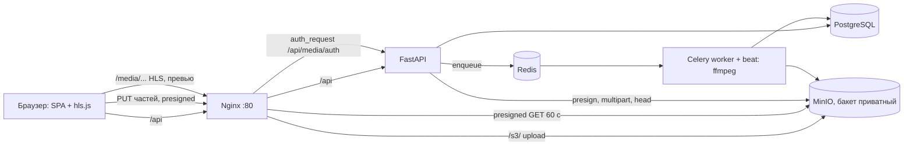

# Архитектура

## Принцип: «видео мимо Python»

Гигабайты не проходят через приложение. API только выдаёт разрешения; байты ходят браузер ↔ Nginx ↔ MinIO.

| Поток         | Как устроен                                                                                                                                                                                                                                                                                                                |
| ------------- | -------------------------------------------------------------------------------------------------------------------------------------------------------------------------------------------------------------------------------------------------------------------------------------------------------------------------- |
| **Загрузка**  | `POST /api/videos` создаёт запись (`uploading`) и multipart-сессию в S3, возвращает presigned-URL на каждую часть (16 МБ). Браузер шлёт части `PUT /s3/...` (Nginx → MinIO, подпись проверяет MinIO). `POST .../upload/complete` склеивает части, проверяет magic bytes и размер, ставит задачу в очередь.                 |
| **Обработка** | Celery-воркер: скачивает исходник → `ffprobe` → `ffmpeg` в HLS 360p (+720p, если исходник ≥720p) + превью → заливает в `videos/<id>/hls/…` и `thumb.jpg` → `status=ready`. Ошибка → `failed` + причина. Почасовой beat-таск `cleanup_stale_uploads` чистит брошенные загрузки старше суток.                                |
| **Раздача**   | `/media/<id>/hls/…` и `/media/<id>/thumb.jpg`. Nginx делает `auth_request` в API; API по cookie `media_token` решает, можно ли (`can_view_video`), и возвращает подписанный внутренний URL MinIO на 60 с. Nginx проксирует его клиенту (Range поддерживается). Оригинал (`source`) и любые другие пути наружу не отдаются. |
