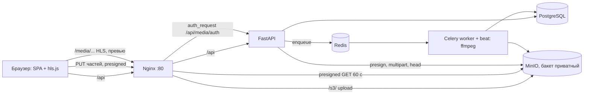

# Архитектура

## Принцип: «видео мимо Python»

Гигабайты не проходят через приложение. API только выдает разрешения; байты ходят браузер ↔ Nginx ↔ MinIO.

| Поток         | Как устроен                                                                                                                                                                                                                                                                                                                |
| ------------- | -------------------------------------------------------------------------------------------------------------------------------------------------------------------------------------------------------------------------------------------------------------------------------------------------------------------------- |
| **Загрузка**  | `POST /api/videos` создает запись (`uploading`) и multipart-сессию в S3, возвращает presigned-URL на каждую часть (16 МБ). Браузер шлет части `PUT /s3/...` (Nginx → MinIO, подпись проверяет MinIO). `POST .../upload/complete` склеивает части, проверяет magic bytes и размер, ставит задачу в очередь.                 |
| **Обработка** | Celery-воркер: скачивает исходник → `ffprobe` → `ffmpeg` в HLS 360p (+720p, если исходник ≥720p) + превью → заливает в `videos/<id>/hls/…` и `thumb.jpg` → `status=ready`. Ошибка → `failed` + причина. Почасовой beat-таск `cleanup_stale_uploads` чистит брошенные загрузки старше суток.                                |
| **Раздача**   | `/media/<id>/hls/…` и `/media/<id>/thumb.jpg`. Nginx делает `auth_request` в API; API по cookie `media_token` решает, можно ли (`can_view_video`), и возвращает подписанный внутренний URL MinIO на 60 с. Nginx проксирует его клиенту (Range поддерживается). Оригинал (`source`) и любые другие пути наружу не отдаются. |

## Ключевые решения

| Решение                                                           | Почему                                                                          |
| ----------------------------------------------------------------- | ------------------------------------------------------------------------------- |
| Бакет приватный, доступ только по подписи                         | Секретность не держится на «неугадываемой ссылке»                               |
| Единая функция `can_view_video` (`app/deps.py`)                   | Одно место правды для метаданных, комментариев, лайков, сегментов и превью      |
| 404 вместо 403 на чужие приватные видео                           | Не раскрываем факт существования                                                |
| Модерация = флаг `is_hidden`, не статус                           | Скрытие не теряет состояние обработки; снятие скрытия возвращает видео как было |
| Роль читается из БД на каждый запрос                              | Смена роли и блокировка действуют сразу, не ждут истечения JWT                  |
| Access JWT 15 мин в памяти + refresh в httpOnly-cookie с ротацией | Кража access недолговечна; refresh недоступен JS                                |
| Отдельный `media_token` в cookie с `Path=/media/`                 | ``, `<video>` и сегменты HLS не умеют слать заголовок Authorization        |
| Нарезка HLS                                                       | Адаптивное качество и перемотка без скачивания всего файла                      |
| Celery + Redis                                                    | Транскодинг долгий; `acks_late`, ретраи, лимит времени                          |

## Жизненный цикл видео

`uploading` → (`complete`) → `processing` → `ready` | `failed`. Независимо: `is_hidden` (модератор) и `visibility` (`public`/`unlisted`/`private`).

## Видимость (`can_view_video`)

1. Владелец, модератор, админ — видят всегда (в т. ч. скрытое и необработанное).
2. Остальным: только `ready` и не `is_hidden`.
3. `public`, `unlisted` — всем; `private` — только тем, кому владелец выдал доступ (`video_shares`).
4. В ленте, поиске и на чужом канале: только `ready` + `public` + не скрытое. `unlisted` открывается по ссылке, но нигде не перечисляется.

## Роли

| Действие                                    | user | moderator | admin             |
| ------------------------------------------- | ---- | --------- | ----------------- |
| Загружать/редактировать/удалять cвои видео  | ✓    | ✓         | ✓                 |
| Удалять чужие видео                         | ✗    | ✗         | ✓                 |
| Смотреть чужие приватные/скрытые            | ✗    | ✓         | ✓                 |
| Скрывать/возвращать видео, разбирать жалобы | ✗    | ✓         | ✓                 |
| Удалять чужие комментарии                   | ✗    | ✓         | ✓                 |
| Менять роли, блокировать пользователей      | ✗    | ✗         | ✓ (себя - нельзя) |

## Критичные инварианты (каждый покрыл автотестами, см. docs/testing.md)

1. Приватное видео недоступно чужому и анониму: метаданные, комментарии, лайки, жалобы, HLS и превью.
2. Скрытое видео отсутствует в ленте, поиске, на канале и в плейлистах; медиа закрыто для всех, кроме владельца и модераторов.
3. Лайк идемпотентен; смена на дизлайк заменяет значение; одна строка на (видео, пользователь).
4. Роли: пользователь не модерирует; модератор не назначает роли; админ не меняет собственную роль.
5. Загрузка доходит до `ready`; не-видео по magic bytes отклоняется и удаляется; ошибка транскодера → `failed`.
6. Фронт не использует `innerHTML` и аналоги — комментарии выводятся как текст (XSS).
7. Refresh-токен одноразовый (ротация); после logout и блокировки пользователя доступ пропадает.

## Ограничения (осознанные)

- Rate limit — в памяти процесса (один uvicorn-воркер). Для горизонтального масштабирования заменить на Redis.
- Один Nginx/один MinIO. Для продакшена: репликация/распределенный режим MinIO, CDN поверх `/media/`.
- Если Redis недоступен в момент `complete`, видео останется в `processing`: повторная постановка в очередь вручную (`celery call transcode_video --args='["<id>"]'`).
- Поиск — по названию (FTS `simple` + подстрока); без ранжирования и морфологии.
- Фронт — «простой», без сборки. Субтитры, рекомендации, история просмотра, уведомления не реализованы.
