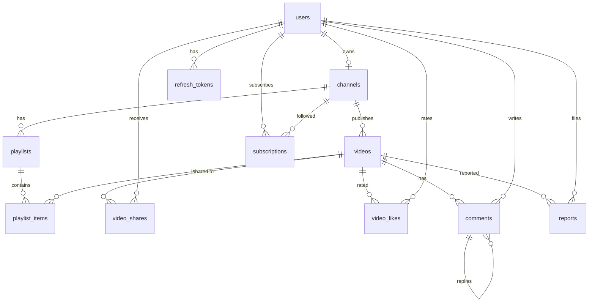

# Проектирование БД

PostgreSQL 16. Миграции - Alembic (`backend/alembic/versions/0001_initial_schema.py` сгенерирована `--autogenerate`; `alembic check` чистый).
Первичные ключи - UUID (не угадываются в URL). Перечисления хранятся как `VARCHAR` + CHECK (добавление значения не требует `ALTER TYPE`).

## Таблицы

| Таблица                       | Назначение                  | Ключевое                                                                                                                                                         |
| ----------------------------- | --------------------------- | ---------------------------------------------------------------------------------------------------------------------------------------------------------------- |
| `users`                       | Аккаунты                    | `email` UNIQUE, `role` (user/moderator/admin), `is_active`, `password_hash` (argon2)                                                                             |
| `refresh_tokens`              | Сессии                      | хранится **SHA-256 хэш** токена, `revoked`, `expires_at`; сам токен в БД не лежит                                                                                |
| `channels`                    | Канал = 1:1 с пользователем | `owner_id` UNIQUE, `handle` UNIQUE (= username в нижнем регистре)                                                                                                |
| `videos`                      | Видео и метаданные          | `status`, `visibility`, `is_hidden`, `hidden_reason`, `source_key`, `hls_prefix`, `thumb_key`, `duration_sec`, `size_bytes`, `views_count`, `upload_id`, `error` |
| `video_shares`                | Доступ к private-видео      | PK (`video_id`, `user_id`)                                                                                                                                       |
| `video_likes`                 | Лайк/дизлайк                | PK (`video_id`, `user_id`) → идемпотентность на уровне БД; CHECK `value IN (1,-1)`                                                                               |
| `comments`                    | Комментарии и ответы        | `parent_id` (самоссылка, CASCADE), `text` ≤ 2000                                                                                                                 |
| `subscriptions`               | Подписки                    | PK (`subscriber_id`, `channel_id`)                                                                                                                               |
| `playlists`, `playlist_items` | Плейлисты                   | PK (`playlist_id`, `video_id`), UNIQUE (`playlist_id`, `position`)                                                                                               |
| `reports`                     | Жалобы                      | UNIQUE (`video_id`, `reporter_id`) — одна жалоба от человека на видео; `status` open/resolved/dismissed, `resolved_by`                                           |

## Что где хранится

- **В БД:** метаданные, права, связи, счётчики, **ключи** объектов.
- **В S3 (бакет `videos`, приватный):** `videos/<id>/source` (оригинал), `videos/<id>/hls/master.m3u8`, `…/360p/*`, `…/720p/*`, `videos/<id>/thumb.jpg`. Удаление видео удаляет префикс `videos/<id>/`.
- Лайки/дизлайки не денормализуются в `videos`: считаются коррелированными подзапросами по PK-индексу (честнее и без рассинхрона; при росте — счётчики + триггер).

## Индексы

| Индекс                                                                                          | Под что                                  |
| ----------------------------------------------------------------------------------------------- | ---------------------------------------- |
| `ix_videos_feed (status, visibility, created_at)`                                               | лента, канал, подписки                   |
| `ix_videos_title_fts` GIN `to_tsvector('simple', title)`                                        | поиск по названию                        |
| `ix_videos_channel_id`, `ix_comments_video (video_id, created_at)`                              | канал, комментарии                       |
| `ix_users_email`, `ix_refresh_tokens_user_id`, `ix_reports_video_id`, `ix_playlists_channel_id` | вход, отзыв сессий, модерация, плейлисты |

## Целостность

- Все внешние ключи с `ON DELETE CASCADE`, кроме `reports.resolved_by` (сохраняем след модератора).
- Ограничения продублированы в БД (CHECK, UNIQUE, PK), а не только в коде приложения.
- Миграции: `docker compose exec api alembic revision --autogenerate -m "..."`; применяются автоматически при старте `api`.
